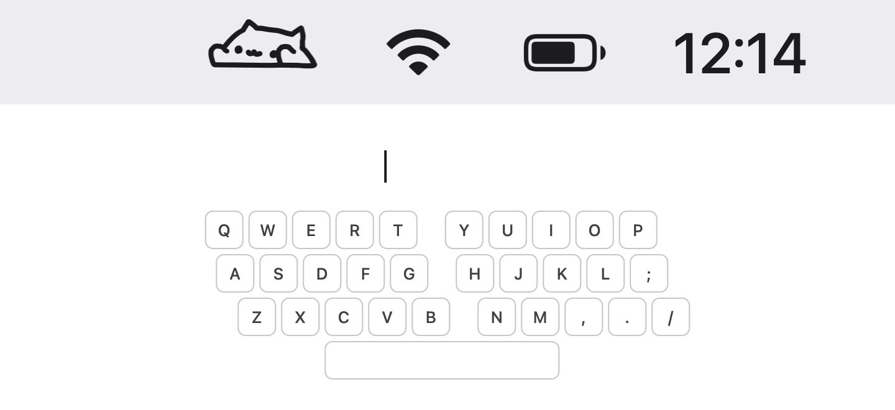
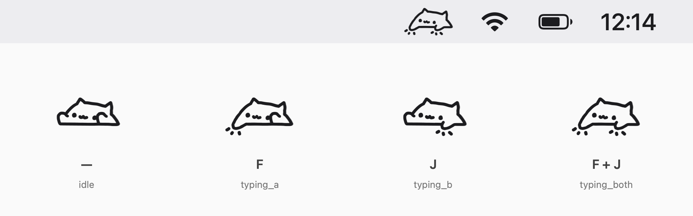

# BongoCat Menubar

[中文](README.md) | English

A Bongo Cat that lives in your Mac's menu bar. You type, it taps its paws.

[](https://github.com/zhiyozhao/bongocat-menubar/releases/latest)


<picture>
  <source media="(prefers-color-scheme: dark)" srcset="docs/assets/demo-dark.gif">
  
</picture>

```bash
brew install --cask zhiyozhao/tap/bongocat-menubar
```

Not using Homebrew? Download the DMG from [Releases](https://github.com/zhiyozhao/bongocat-menubar/releases/latest) and drag the app into Applications.

## Highlights

- Type with your left hand and the left paw taps; type with your right hand and the right paw taps. Press both sides at once and both paws come down.
- Takes up one icon in the menu bar. No window, nothing in the Dock.
- Shift, Control, Option and Command count too, left and right separately.
- Easy to see on both light and dark menu bars.
- Can start automatically when you log in.
- English and Chinese interface, following your system language.
- Runs on macOS 13 or later, on both Apple silicon and Intel Macs.

## First launch

1. Open BongoCat Menubar. The cat appears in the menu bar.
2. It asks for Accessibility permission. Click "Open Settings" and turn on BongoCat Menubar under System Settings → Privacy & Security → Accessibility.
3. No need to restart the app. Within two seconds the cat starts typing along with you.

**Why this permission?** The cat needs to know when you press and release which key so it can move the right paw. macOS requires your approval under Accessibility before any app can notice key presses while you are using other apps.

**Is it safe?** The permission is only used to listen. BongoCat Menubar never blocks, changes or types keys for you, and it does not operate other apps. You can turn the switch off on the same settings page at any time, and after that it receives no key presses at all.

Click the cat in the menu bar to switch modes, turn Launch at Login on or off, or quit.

## Two modes

<picture>
  <source media="(prefers-color-scheme: dark)" srcset="docs/assets/demo-dark.png">
  
</picture>

- **Follow Mode** (default): keys on the left half of the keyboard tap the left paw, keys on the right half (including Space and the arrow keys) tap the right paw. Hold a key and the paw stays down until you let go.
- **Normal Mode**: no left or right. Every key press alternates the paws. Half a second after you stop, the cat rests again.

The app remembers which mode you chose.

## Privacy

- It only looks at which key went down or up. It does not read the text you type.
- Key information is used to pick the cat's pose and then discarded. Nothing is logged or saved to a file.
- The app has no networking features and uploads nothing.
- The only thing saved on your Mac is the mode you chose.

## FAQ

**Opening the app from the DMG says the developer cannot be verified.**
The app is not notarized by Apple, so macOS blocks the first launch. Go to System Settings → Privacy & Security and click "Open Anyway" near the bottom. It will not ask again. Installing with Homebrew avoids this prompt.

**I granted permission but the cat does not move.**
In System Settings → Privacy & Security → Accessibility, turn BongoCat Menubar off and on again. If that does not help, remove it with the "−" button below the list, reopen the app and grant permission again.

**The cat does not move while I type a password.**
That is macOS protecting you: while you type into a password field (or a terminal with "Secure Keyboard Entry" on), the system does not tell any third-party app about key presses. It recovers once you leave that field.

**Do I need to grant permission again after upgrading?**
Since 1.0.0 the permission survives upgrades. Upgrading from an older version needs one more grant.

**I don't use QWERTY. Are left and right still correct?**
Yes. Left and right follow the physical position of the keys, whatever input source or keyboard layout you use.

**Why do some keys do nothing?**
The numeric keypad, Caps Lock, fn, Home, End, Page Up, Page Down, Forward Delete and F13 and above do not move the cat.

**How do I uninstall?**
First turn off "Launch at Login" in the cat's menu (if you turned it on). Then run `brew uninstall --cask bongocat-menubar`, or drag the app from Applications to the Trash. To clear the permission entry too, remove it from the Accessibility list with the "−" button.

## License

[MIT](LICENSE)

---

[Changelog](CHANGELOG.md) · [Development notes (Chinese)](docs/DEVELOPMENT.md)
