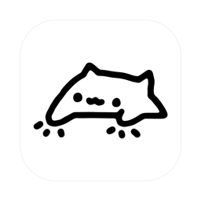
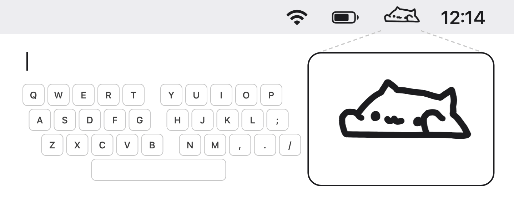

<p align="right"><a href="README.md">中文</a> | English</p>

<p align="center"></p>

<h1 align="center">BongoCat Menubar</h1>

<p align="center">
  <a href="https://github.com/zhiyozhao/bongocat-menubar/releases/latest"></a>
  
  <a href="https://zhiyozhao.github.io/bongocat-menubar/en/"></a>
</p>

<p align="center">A cat in your Mac menu bar. You type, it taps its paws: left hand, left paw; right hand, right paw.</p>

<p align="center">
  <picture>
    <source media="(prefers-color-scheme: dark)" srcset="docs/assets/demo-dark.gif">
    
  </picture>
</p>

## Install

### Step 1: Install the app (either way)

- **Homebrew**

  ```bash
  brew install --cask zhiyozhao/tap/bongocat-menubar
  ```

- **Manually**: download the DMG from [Releases](https://github.com/zhiyozhao/bongocat-menubar/releases/latest) and drag the app into Applications. If the first launch says the developer cannot be verified, go to System Settings → Privacy & Security and click "Open Anyway" at the bottom.

### Step 2: Grant Accessibility permission

Open the app, click "Open Settings" in the prompt, then "Open System Settings", and turn on BongoCat Menubar.

## FAQ

**The cat doesn't move.**\
Open the cat's menu. If it shows an "Accessibility" item, permission isn't granted yet: click it and turn the switch on. If permission is granted, turn the switch off and on again in Settings. The cat stays still while you type a password; that's normal.

**I can't find the cat in the menu bar.**\
When the menu bar is full, the notch hides the cat. Quit a few menu bar apps and it will show up.

**Does it record what I type?**\
No. It has no network access and saves no keystrokes.

**How do I upgrade?**\
`brew upgrade --cask bongocat-menubar`, then open the app again. No need to grant permission again.

**How do I uninstall?**\
`brew uninstall --cask bongocat-menubar`, or drag the app to the Trash.

---

[MIT license](LICENSE) · [Changelog](CHANGELOG.md) · [Development notes (Chinese)](docs/DEVELOPMENT.md)
