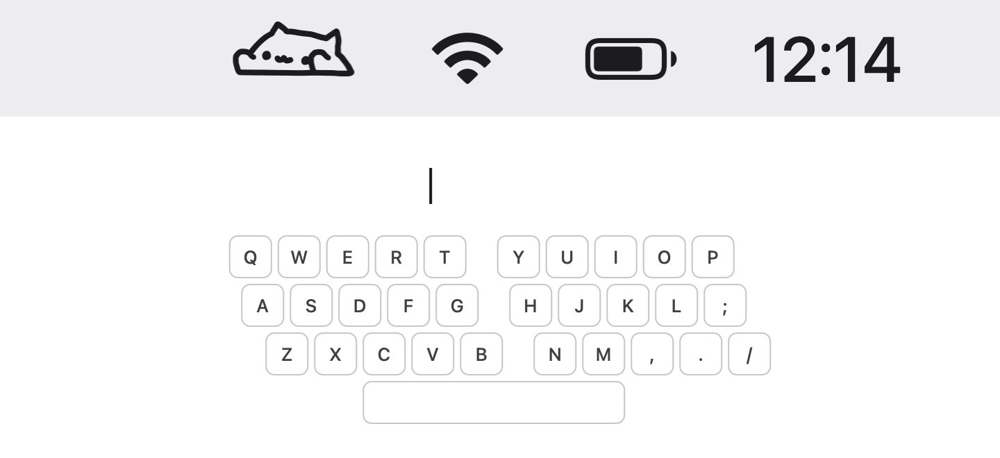

# BongoCat Menubar

中文 | [English](README.en.md)

住在 macOS 菜单栏里的 Bongo Cat：你敲键盘，它就跟着拍爪子。没有窗口，没有 Dock 图标。

[](https://github.com/zhiyozhao/bongocat-menubar/releases/latest)
[](https://github.com/zhiyozhao/bongocat-menubar/actions/workflows/check.yml)


<picture>
  <source media="(prefers-color-scheme: dark)" srcset="docs/assets/demo-dark.gif">
  
</picture>

（演示图由 `Resources/Icons/` 里的真实图标渲染，菜单栏放大了 2.5 倍。）

## 功能

- 菜单栏小猫随键盘敲击做动画，浅色、深色菜单栏自动适配。
- 两种模式：**跟随模式**分左右手（左手区的键拍左爪、右手区的键拍右爪、两边一起按就双爪）；**普通模式**每按一下左右爪交替。
- 修饰键（Shift、Control、Option、Command）也会动，并按左右侧区分。
- 可设置开机启动。
- 界面跟随系统语言，支持简体中文和英文。
- 只在本机读取按键事件来驱动动画，不记录、不上传（见[隐私](#权限与隐私)）。

## 安装

系统要求：macOS 13 或更新，Apple Silicon 和 Intel 都支持。

### Homebrew（推荐）

```bash
brew install --cask zhiyozhao/tap/bongocat-menubar
```

升级用 `brew upgrade --cask bongocat-menubar`。cask 安装后会去掉下载隔离标记，首次打开不会被 Gatekeeper 拦下。

### 下载 DMG

1. 到 [Releases](https://github.com/zhiyozhao/bongocat-menubar/releases/latest) 下载 `BongoCat-Menubar-v<版本>.dmg`。
2. 打开 DMG，把 `BongoCat Menubar.app` 拖进“应用程序”。
3. 首次打开时 macOS 会提示“无法验证开发者”，因为 app 是**自签名**的（证书名 `DEV X`），没有 Apple Developer ID 签名和公证。处理方法二选一：
   - 先双击打开一次，被拦下后到“系统设置 → 隐私与安全性”，在页面下方点“仍要打开”；
   - 或在终端执行：

     ```bash
     xattr -dr com.apple.quarantine "/Applications/BongoCat Menubar.app"
     ```

## 快速上手

1. 打开 app，菜单栏出现小猫图标。
2. 首次运行会弹窗请求**辅助功能**权限，点“打开设置”，在“系统设置 → 隐私与安全性 → 辅助功能”里打开 BongoCat Menubar。
3. 授权后无需重启，app 每 2 秒检查一次，拿到权限就开始响应按键。
4. 点菜单栏小猫可以切换模式、开关开机启动、退出。

## 两种模式

| 模式 | 规则 |
|---|---|
| 跟随模式（默认） | 按住左手区的键抬左爪，右手区抬右爪，两边都按着就双爪齐拍，全部松开回到待机。 |
| 普通模式 | 每按一次键，左右爪交替一次；停止敲击 0.5 秒后回到待机。 |

左右手按 QWERTY 键盘的物理位置划分：

- 左手：Esc、F1–F5、`` ` `` 和 1–5、Tab 和 Q–T、A–G、左 Shift 和 Z–B、左 Control / Option / Command。
- 右手：F6–F12、6–0、`-`、`=`、Delete、Y–P、`[`、`]`、`\`、H–L、`;`、`'`、Return、N–M、`,`、`.`、`/`、右 Shift、空格、右 Command / Option / Control、方向键。
- 不触发动画：Caps Lock、数字小键盘、fn、向前删除、Home / End / Page Up / Page Down、F13 以上。

选择的模式会被记住，下次启动沿用。

## 权限与隐私

**为什么需要辅助功能权限**：app 要知道你什么时候按下、松开了哪个键，才能让小猫拍对应的爪子。macOS 只有在获得辅助功能授权后，才允许 app 用 CGEvent tap 监听全局键盘事件。

**app 实际做了什么**（与源码一致，见 `Sources/BongoCatMenubar/KeyboardMonitor.swift`）：

- 以只监听（`listenOnly`）方式接收按下、松开和修饰键变化三类事件，不拦截、不修改、不注入任何按键。
- 每个事件只读取按键编号（keycode），修饰键事件再读一下修饰键状态，用来判断是哪只手、按下还是松开。不读取你输入的字符内容。
- 按键信息只在内存里用于切换图标帧，不写日志、不存文件。
- app 不包含任何联网代码，不上传任何数据。
- 唯一保存到本机的设置是“当前模式”（`UserDefaults` 里的 `followHands`）。开机启动通过系统的 `SMAppService` 注册。

没有授权时，app 只显示菜单栏图标，菜单里会出现“辅助功能”入口提醒你授权。

## 从源码构建

需要 Xcode 16 或更新（本地在 Xcode 26.3 上验证过），不需要其他依赖。

```bash
git clone https://github.com/zhiyozhao/bongocat-menubar.git
cd bongocat-menubar
make check     # 构建 + 单元测试
make run       # 打包 release 版 .app 并在前台运行，Ctrl-C 退出
make package   # 产出 .build/release/BongoCat Menubar.app 和 BongoCat-Menubar-v<版本>.dmg
```

签名：钥匙串里有名为 `DEV X` 的证书时用它签名，否则回退为 ad-hoc 签名。ad-hoc 签名的 app 每次重新构建后都要重新授予辅助功能权限。

## 常见问题

**授权了，小猫还是不动？**
到“系统设置 → 隐私与安全性 → 辅助功能”里把 BongoCat Menubar 关掉再打开；还不行就用 `-` 按钮删掉条目后重新添加。也可以重置授权后重新打开 app：

```bash
tccutil reset Accessibility com.zhiyozhao.bongocat-menubar
```

**在密码框或某些终端里打字时小猫不动？**
这是 macOS 的“安全输入”机制：密码框、开启了“安全键盘输入”的终端等场景下，系统不会把按键事件发给任何第三方 app。离开这些输入框就恢复。

**升级后要重新授权吗？**
从 v1.0.0 起，所有版本都用同一个 `DEV X` 证书签名，升级后授权保留。从更早的版本升级上来时需要重新授权一次。

**用的不是 QWERTY 布局（如 Dvorak、AZERTY）怎么办？**
左右手按物理按键位置划分，与系统输入法和键盘布局无关，所以左半边键盘仍然对应左爪。

**数字小键盘为什么不动？**
数字小键盘和 Home / End 这类键不在左右手划分里，按设计不触发动画。

**怎么卸载？**

```bash
brew uninstall --cask bongocat-menubar          # 或直接把 app 从“应用程序”删掉
tccutil reset Accessibility com.zhiyozhao.bongocat-menubar
defaults delete com.zhiyozhao.bongocat-menubar  # 清除保存的模式设置
```

开过开机启动的话，先在菜单里关掉再卸载。

## 更新记录

见 [CHANGELOG.md](CHANGELOG.md)。
