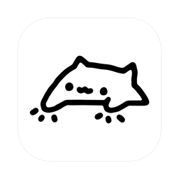
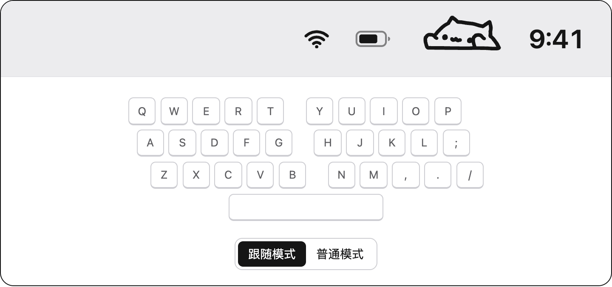

<p align="right">中文 | <a href="README.en.md">English</a></p>

<p align="center"></p>

<h1 align="center">BongoCat Menubar</h1>

<p align="center">
  <a href="https://github.com/zhiyozhao/bongocat-menubar/releases/latest"></a>
  
  <a href="https://zhiyozhao.github.io/bongocat-menubar/"></a>
</p>

<p align="center">住在 Mac 菜单栏里的 Bongo Cat，你一打字，它就跟着拍爪子。</p>

<p align="center">
  <picture>
    <source media="(prefers-color-scheme: dark)" srcset="docs/assets/demo-zh-dark.gif">
    
  </picture>
</p>

## 安装

### 第 1 步：安装 app（二选一）

#### 用 Homebrew

```bash
brew install --cask zhiyozhao/tap/bongocat-menubar
```

#### 手动安装

到 [Releases](https://github.com/zhiyozhao/bongocat-menubar/releases/latest) 下载 DMG，把 app 拖进“应用程序”。第一次打开如果提示“无法验证开发者”，到“系统设置 → 隐私与安全性”，在页面底部点“仍要打开”。

### 第 2 步：授权辅助功能

打开 app，在弹窗里点“打开设置”，再点“打开系统设置”，然后打开 BongoCat Menubar 的开关。

## 常见问题

### 小猫不动？

点开小猫的菜单：有“辅助功能”这一项，说明还没授权，点它去打开开关；已经授权了，就在设置里把开关关掉再打开。输入密码时小猫不动是正常的。

### 菜单栏里找不到小猫？

菜单栏图标太多时，小猫会被刘海挡住。退出几个菜单栏 app 就能看到。

### 会记录我打的字吗？

不会。它不联网，也不保存任何按键。

### 怎么升级？

`brew upgrade --cask bongocat-menubar`，装好后重新打开 app，不用重新授权。

### 怎么卸载？

`brew uninstall --cask bongocat-menubar`，或者把 app 拖到废纸篓。

---

[MIT 许可证](LICENSE) · [更新记录](CHANGELOG.md) · [开发文档](docs/DEVELOPMENT.md)
